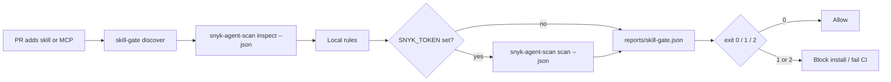

# minilab-agent-scan-skill-gate

**Built by SkilledDragon LLC — architecture-led software engineering — [skilleddragon.com](https://skilleddragon.com)**

Palette: `#020617` / `#040F49` / `#006BDF` / `#00BFA6`

Front-door lock (**candado**): block a PR that adds a Claude Code / Cursor skill or MCP server until [Snyk Agent Scan](https://github.com/snyk/agent-scan) has inspected it (keyless) and, when `SNYK_TOKEN` is configured, analyzed it for prompt injection, tool poisoning, and toxic flows.

| Piece | Purpose |
| --- | --- |
| `uv run skill-gate check <paths...>` | Discover `SKILL.md` / MCP configs, run `snyk-agent-scan inspect --json`, apply local rules, optional live `scan` |
| `uv run skill-gate changed --base origin/main` | Same gate for paths changed in git |
| `.claude/skills/gate-new-skill/` | Skill that requires the gate before install |
| `upstream/` | git submodule pin of `snyk/agent-scan` @ `v0.6.8` |
| `reports/skill-gate.json` | Machine-readable gate report |

Upstream pin: [snyk/agent-scan](https://github.com/snyk/agent-scan) @ `2d244047643decb874a197bc64cbe6fc3e586f2a` (tag `v0.6.8`, Apache-2.0) · PyPI [`snyk-agent-scan==0.6.8`](https://pypi.org/project/snyk-agent-scan/0.6.8/)

## What we built and why

Same week Anthropic published distillation defenses and GitHub began blocking Anthropic API keys by default, builders got a clear lesson: put a lock on your own agent supply chain before a skill or MCP lands in the repo.

Context (vendor claims — hedge them):

- Anthropic, [Strengthening our defenses against distillation attacks](https://www.anthropic.com/research/distillation-defenses) (2026-10-12). Anthropic reports reasoning tokens extracted by distillers fell roughly 90–99%, a two-stage classifier at under 0.1% false positives, and tens of thousands of accounts banned.
- GitHub Changelog, [Secret scanning blocks Anthropic keys by default](https://github.blog/changelog/2026-10-13-secret-scanning-blocks-anthropic-keys-by-default-adds-salesforce) (2026-10-13).

This lab’s candado is a PR-time gate: keyless `inspect` + deterministic local rules always; live `scan` only with `SNYK_TOKEN`.



## What we tested

Verified upstream commands at `2d244047643decb874a197bc64cbe6fc3e586f2a`:

```bash
git -C upstream rev-parse HEAD
# must print 2d244047643decb874a197bc64cbe6fc3e586f2a

cd upstream
uv run --frozen --extra test -m pytest --runner=uv tests/unit
```

Lab keyless suite:

```bash
uv sync --locked --group dev
uv run ruff check .
uv run ruff format --check .
uv run pytest -q
python3 scripts/check-skills
python3 scripts/check-banned-phrases
python3 scripts/check-upstream-parity
```

Real pass counts, durations, and tool versions: [RESULTS.md](RESULTS.md).

## Setup

Requires Python `>=3.10` (CI uses 3.12) and [uv](https://docs.astral.sh/uv/).

```bash
git clone --recurse-submodules https://github.com/SkilledDragonCorp/minilab-agent-scan-skill-gate.git
cd minilab-agent-scan-skill-gate
cp .env.example .env
uv sync --locked --group dev
```

Confirm the submodule pin:

```bash
git -C upstream rev-parse HEAD
git -C upstream rev-list -n1 v0.6.8
```

Both commands must print `2d244047643decb874a197bc64cbe6fc3e586f2a`.

Optional pre-commit (gitleaks `v8.30.1`):

```bash
uv run pre-commit install
```

## Tutorial

1. Fail closed on the malicious fixture (copied from upstream at the pin; see `tests/fixtures/malicious-skill/ATTRIBUTION.md`):

```bash
uv run skill-gate check tests/fixtures/malicious-skill
echo $?
# expected: 1
# reports/skill-gate.json written
```

2. Pass the clean fixture:

```bash
uv run skill-gate check tests/fixtures/clean-skill
echo $?
# expected: 0
```

3. JSON output:

```bash
uv run skill-gate check tests/fixtures/clean-skill --json
```

4. Optional live analysis (sends component content to Snyk per upstream `TERMS.md`):

```bash
# set SNYK_TOKEN in .env first
uv run skill-gate check tests/fixtures/malicious-skill --json
uv run pytest -q -m live
```

## Using these skills in Claude Code and Cursor

Both tools auto-discover `.claude/skills/<name>/SKILL.md` from the repository root.

| Tool | How to invoke |
| --- | --- |
| Claude Code | Ask to use skill `gate-new-skill` before installing another skill or MCP server |
| Cursor | Same path: `.claude/skills/gate-new-skill/SKILL.md` is loaded from the repo; instruct the agent to follow `gate-new-skill` |

Do not create `.cursor/skills` or `.agents/skills` mirrors. CI job `skills-layout` fails if those directories exist.

## API keys

| Variable | Required | Where | Cost | Slice | Minimum scope |
| --- | --- | --- | --- | --- | --- |
| `SNYK_TOKEN` | optional | [app.snyk.io/account](https://app.snyk.io/account) | free tier | live `scan` / `pytest -m live` | Snyk API token for Agent Scan analysis |
| `AGENT_SCAN_ENVIRONMENT` | optional (default `test`) | local / CI | free | labels upstream requests | string label only |
| `AGENT_SCAN_CI_HOSTNAME` | optional | Snyk-internal (not used keyless) | n/a | upstream-full workflow_dispatch | hostname secret |

Identical names with empty values ship in `.env.example`.

### Telemetry / environment surface (upstream at the pin)

Command used:

```bash
rg -n "os.environ|getenv|telemetry|analytics" upstream/src | head -80
```

Documented variables from that grep (and CLI docs at the pin):

| Variable | Role / opt-out note |
| --- | --- |
| `SNYK_TOKEN` | Enables analysis API; omit for keyless inspect-only |
| `AGENT_SCAN_ENVIRONMENT` | Request environment label (`test` / `ci` / `production`) |
| `AGENT_SCAN_CI_HOSTNAME` | CI hostname header for Snyk-internal runs |
| `SNYK_CLI_USE` | Upstream alternate auth path; leave unset for this lab |
| `AGENT_SCAN_COMMAND` | Guard/hooks installer path; unused by `skill-gate` |
| `PUSH_KEY` / `TENANT_ID` / `MACHINE_ID` | Upstream push-key / control-plane flows; unused by keyless gate |
| `REMOTE_HOOKS_BASE_URL` | Remote hooks base; unused by keyless gate |
| `AI_AGENT` / `COPILOT_CLI` / `COPILOT_HOME` | Agent discovery hints |
| `CLAUDE_CONFIG_DIR` / `CLAUDE_CODE_PLUGIN_*` | Claude Code discovery overrides |
| `OPENCODE_CONFIG` / `OPENCODE_CONFIG_DIR` / `OPENCODE_DB` | OpenCode discovery overrides |
| `CODEX_HOME` | Codex discovery override |

This lab never passes `--dangerously-run-mcp-servers`. Keyless tests pass only `SKILL.md` files and skill directories.

## License

Apache-2.0 (this repository). Upstream `snyk/agent-scan` / `snyk-agent-scan` is Apache-2.0; see `upstream/LICENSE` and `upstream/TERMS.md` at the pin.
